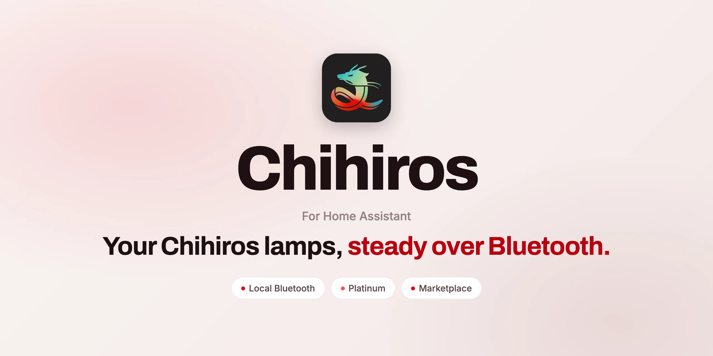

<div align="center">

<picture>
  <source media="(prefers-color-scheme: dark)" srcset="docs/images/readme-title-dark.webp" />
  
</picture>

[](https://github.com/SH1FT-W/chihiros/releases/latest)
[](https://www.home-assistant.io)
[](https://hacs.xyz)

<a href="https://sh1ft-w.github.io/chihiros"><b>Website</b></a>&emsp;<a href="#supported-devices">Devices</a>&emsp;<a href="#install">Install</a>&emsp;<a href="#set-up">Set up</a>&emsp;<a href="#entities">Entities</a>&emsp;<a href="CHANGELOG.md">Changelog</a>

</div>

<br/>

Your Chihiros LED lamps and the Chihiros dosing pump in Home Assistant: **every channel as a slider, schedules written to the lamp, doses and dosing programs.** Over Home Assistant's Bluetooth or ESPHome Bluetooth proxies, without the app and without cloud.

It is a complete rewrite of [TheMicDiet/chihiros-led-control](https://github.com/TheMicDiet/chihiros-led-control) with **the same domain `chihiros`** and the same unique IDs, so entities, history and automations stay when you [switch](#switching). For the same reason **the two cannot be installed at the same time.**

<a id="supported-devices"></a>
## Supported devices

The model is detected from the Bluetooth name, and Home Assistant discovers the devices by itself.

| Device | Bluetooth name starts with | Channels | Tested on hardware |
|:--|:--|:--|:--:|
| C II RGB | `DYNCRGP`, `DYNCRGB` | red, green, blue | ✓ |
| Dosing pump, 1 to 8 channels | `DYDOSE` | | ✓ (4 channels) |
| A II | `DYNA2`, `DYNA2N` | white | |
| WRGB II | `DYWRGB`, `DYNT90`, `DYNW30`, `DYNW45`, `DYNW60`, `DYNW90`, `DYNW12P`, `DYNWRGB` | red, green, blue | |
| WRGB II Pro | `DYWPRO30` … `DYWPRO90`, `DYWPR120` | red, green, blue, white | |
| WRGB II Slim | `DYSILN`, `DYSL30` … `DYSL120`, `DYSL12` | red, green, blue | |
| WRGB VIVID III | `DYVVD3` | red, green, blue, white + fan | |
| Universal WRGB | `DYU550` … `DYU1500` | red, green, blue, white | |
| SEA_LED | `DYSEA` | red, green, blue, white | |
| Tiny Terrarium Egg | `DYDD` | red, green | |
| Z Light TINY | `DYSSD`, `DYZSD` | white, warm white | |
| Commander 1 | `DYCOM` | white, RGB or WRGB (chosen during setup) | |
| Commander 4 | `DYLED`, `DYNLED` | red, green, blue, white | |
| Commander X | `DYONE` | white | |

The untested lamps speak the same protocol as the C II RGB and are built from the protocol documentation of the original integration. Own one? Please [report](https://github.com/SH1FT-W/chihiros/issues/new?template=bug.yml) whether it works, with the model and the Bluetooth name. Heaters (`DYHET`, `DYH1T`) and magnetic stirrers (`DYMIXR`) are left out on purpose; for those, use the original integration instead.

**New in 26.11:** the container level keeps counting after a totals reset, and discovery ignores ghost devices from Bluetooth proxies. Every change is in the [changelog](CHANGELOG.md).

<a id="install"></a>
## Install

[](https://my.home-assistant.io/redirect/hacs_repository/?owner=SH1FT-W&repository=chihiros&category=integration)

Search for **Chihiros** under **Settings > Marketplace** (called HACS before Home Assistant 2026.11), download it and restart Home Assistant.

<details>
<summary>Install by hand</summary>

1. Download the [latest release](https://github.com/SH1FT-W/chihiros/releases/latest).
2. Copy `custom_components/chihiros` into `/config/custom_components/` and restart Home Assistant.

</details>

<a id="set-up"></a>
## Set up

Before you start, you need a connectable Bluetooth adapter or an ESPHome Bluetooth proxy in range of the device, with a free connection slot. Close the My Chihiros app: the device takes only one connection.

1. **Add the device.** Devices in range show up under **Settings > Devices & services > Discovered**.
2. **Answer the one question.** For the dosing pump, the number of pump channels (1 to 8, default 4). For a Commander 1, the connected lamp (white, RGB or WRGB). Other devices need nothing.
3. **Low container push, if you like.** Under **Configure** on the pump.

The pump channel count can be changed later with **three dots > Reconfigure**; entities of channels no longer used are removed.

<a id="switching"></a>
### Switching from the original integration

1. **Remove "chihiros" by TheMicDiet** in the Marketplace. Keep the integration entries.
2. **Install this integration** and restart Home Assistant. Existing entries, entities, history and automations are taken over.

Two old entities stay behind as "no longer provided" (`…_last_notification` and `…_calibrate_pump`); calibrating now works with `chihiros.calibrate_pump`.

<a id="entities"></a>
## Entities

Entity IDs start with the device name, for new devices the Bluetooth name (for example `light.dyncrgp…`). Names are in English and German.

| Lamp | Shows |
|:--|:--|
| Light | Brightness, RGB or RGBW as the lamp has them, with `transition`. Brightness keeps the mix, switching on brings back the last mix. Attribute `channels` in %. |
| Red, Green, Blue, White, Warm white | One slider per channel of the model, 0 to 100 %, like in the app |
| Auto mode | The lamp plays its stored daily schedule by itself, even without Home Assistant |
| Scene | Red plants, green, Buce, fish, shrimp, all, or back to the schedule (RGB lamps) |
| Feeding light | Bright for 1 to 120 minutes (Feeding light duration), then back to the previous state |
| Sun cycle | Schedule after the real sunrise and sunset, within Sun cycle earliest on and latest off, recalculated every night |
| Acclimatization | A new tank starts dimmed (10 to 100 %) and reaches full brightness after 1 to 12 weeks |

| Dosing pump, per channel | Shows |
|:--|:--|
| Dose pump, Dose volume | Dose now with the set volume |
| Today, Total | Counters from the pump, every 30 minutes and after every dose |
| Container size, Container refilled, Remaining, Lasts | Container level and how many days it lasts. Push when it runs low, repair notice below 10 %. |
| Program | The dosing program the pump runs by itself |
| Active, Catch up missed doses | Per channel, plus the pump's Dosing delay |

<details>
<summary>Fan, Home Assistant counters and diagnostics</summary>

| Entity | Shows |
|:--|:--|
| Fan, Fan speed, Temperature | WRGB VIVID III: speed 25 to 100 % or automatic by temperature. Updated whenever Home Assistant talks to the lamp, at least once an hour. |
| Daily schedule | Points of the schedule written to the lamp |
| Feeding light until | End of the feeding light |
| Pump today via HA, total via HA, doses via HA, last calibrated | Home Assistant's own pump counters |
| Reachable | Diagnostic, with `last_error`, `connects` and `failures` |
| Signal strength, Last contact, Firmware | Diagnostic |

</details>

## Examples

Channels like in the app (only the channels the lamp has; missing ones stay):

```yaml
action: chihiros.set_channels
target:
  entity_id: light.my_lamp
data: {red: 70, green: 70, blue: 70, white: 40, transition: 600}
```

<details>
<summary>Daily schedule in the lamp, it runs it by itself afterwards</summary>

```yaml
action: chihiros.set_auto_curve
target:
  entity_id: light.my_lamp
data:
  points:
    - {time: "09:00", red: 0, green: 0, blue: 0}
    - {time: "10:00", red: 70, green: 70, blue: 70}
    - {time: "19:00", red: 70, green: 70, blue: 70}
    - {time: "19:30", red: 0, green: 0, blue: 0}
```

</details>

<details>
<summary>Daily dosing program: channel 1, 08:00 and 20:00, 1.5 ml each</summary>

```yaml
action: chihiros.set_dosing_program
data: {device_id: <dosing pump>, pump: 1, times: ["08:00", "20:00"], ml: 1.5}
```

</details>

<details>
<summary>All actions</summary>

| Action | Target | Main fields |
|:--|:--|:--|
| `chihiros.set_channels` | light entity | `red`, `green`, `blue`, `white`, `warm` (0 to 100 %, missing ones stay), `transition` (s) |
| `chihiros.set_auto_curve` | light entity | `points` (2 to 16 × `time` + channels), `activate` |
| `chihiros.set_weekday_schedule` | light entity | `settings` (up to 7 × `weekdays`, `sunrise`, `sunset`, `ramp`, channels); lite controllers only one setting for every day |
| `chihiros.dose` | `device_id`, `pump` | `ml` (empty = the set dose volume) |
| `chihiros.calibrate_pump` | `device_id`, `pump` | first `seconds` (test run), then `measured_ml` |
| `chihiros.set_dosing_program` | `device_id`, `pump` | `mode` (`daily`/`once`/`timer`/`spread`), `times` + `ml` or `doses`, `weekdays`; for `spread` `start`, `duration`, `count`, `daily_ml` |
| `chihiros.clear_dosing_program` | `device_id`, `pump` | |
| `chihiros.reset_pump_totals` | `device_id`, `pump` | |
| `chihiros.set_container_remaining` | `device_id`, `pump` | `ml`: current content, counted down from here |
| `chihiros.send_raw` | `device_id` | `frames` (`cmd`, `mode`, `params`), `wait`; troubleshooting only, returns the replies |

If the device is not reachable or an input does not fit (for example channel 5 on a 4-channel pump or `white` on an RGB lamp), the action reports an error instead of silently doing nothing.

</details>

## Good to know

- **Doses are never repeated.** If the connection breaks during a dose, an error appears: check the counter to see whether it dosed.
- **The lamp does not report its colour.** Home Assistant shows its last command, in auto mode the stored schedule. After a change in the app or with the remote, it shows its own state until it sends something again. After a power cut it sets the clock and, in manual mode, the colour again.
- **One connection at a time, kind to proxies.** Commands to the same device wait for each other, one operation takes at most 40 seconds, and the connection closes after 15 seconds idle. Home Assistant's start is never blocked; the first contact runs in the background.
- **Reachability** comes from the Bluetooth advertisements: if no proxy sees the device, its entities become unavailable.
- **Older lamps** (Commander X, Commander 1, Commander 4 `DYLED`, WRGB II `DYWRGB`, Terrarium Egg, Z Light TINY) store schedule points in 30-minute steps, like the app. Checking a written schedule works only on the newer SeaLed family, up to 8 points and on the first channel.

<details>
<summary>Troubleshooting</summary>

- **Entities "unavailable"** (only "reachable" stays, showing "disconnected"). No Bluetooth proxy sees the device: check power, move a proxy closer or free connection slots on it.
- **Action reports "not reachable".** The reason is in the message and in the "reachable" sensor. Typical: all connection slots of the proxy are in use, or the app still holds the device.
- **Raw commands:** `chihiros.send_raw` sends commands unchanged and returns the replies.
- **Debug log:**

  ```yaml
  logger:
    logs:
      custom_components.chihiros: debug
  ```

When you open an [issue](https://github.com/SH1FT-W/chihiros/issues), attach the diagnostics (**Settings > Devices & services > Chihiros > three dots > Download diagnostics**: connection statistics, stored state and the last events, without the Bluetooth address) and name the model and the Bluetooth name.

</details>

<details>
<summary>Remove</summary>

1. **Settings > Devices & services > Chihiros > three dots > Delete** (per device). The schedule or dosing program stays stored in the device and keeps running.
2. Remove the repository in the Marketplace (or delete `/config/custom_components/chihiros`) and restart Home Assistant.

</details>

<details>
<summary>How it works</summary>

| Part | What it does |
|:--|:--|
| One connection | Over Home Assistant's Bluetooth or ESPHome proxies, a lock per device, a hard time limit, disconnected after 15 seconds idle |
| The app's frames | Channel levels, modes, schedule points and dosing commands, as the My Chihiros app sends them |
| Remembered state | The lamp does not report its colour, so Home Assistant keeps the last state and restores it after a power cut |

The Bluetooth protocol and the model table follow the documentation of [TheMicDiet/chihiros-led-control](https://github.com/TheMicDiet/chihiros-led-control) (MIT), which decoded the "My Chihiros" app and checked it with captures; thanks for the groundwork. Details are in [`NOTICE`](NOTICE) and, in German, in [`CLAUDE.md`](CLAUDE.md).

</details>

<details>
<summary>Development</summary>

```bash
.venv/bin/python -m pytest -q -p no:logging --cov=custom_components/chihiros   # fake devices in tests/conftest.py
uvx ruff check . && uvx ruff format --check .
uvx mypy@2.3.1 --python-executable .venv/bin/python
.venv/bin/python tools/pruefe-uebersetzungen.py    # strings.json against translations/*.json
```

Test requirements: `pip install -r requirements_test.txt`. The tests replace Bluetooth completely with simulated devices. GitHub Actions runs the same checks plus HACS validation and hassfest. Quality scale: platinum, [self-assessed](custom_components/chihiros/quality_scale.yaml).

</details>

## License

[Apache License 2.0](LICENSE), Copyright 2026 SH1FT-W. Acknowledgements and the license of the original integration in [`NOTICE`](NOTICE).

<sub>Chihiros (this integration) is an independent project, not affiliated with, endorsed or sponsored by Chihiros. Chihiros is a trademark of its owner.</sub>
