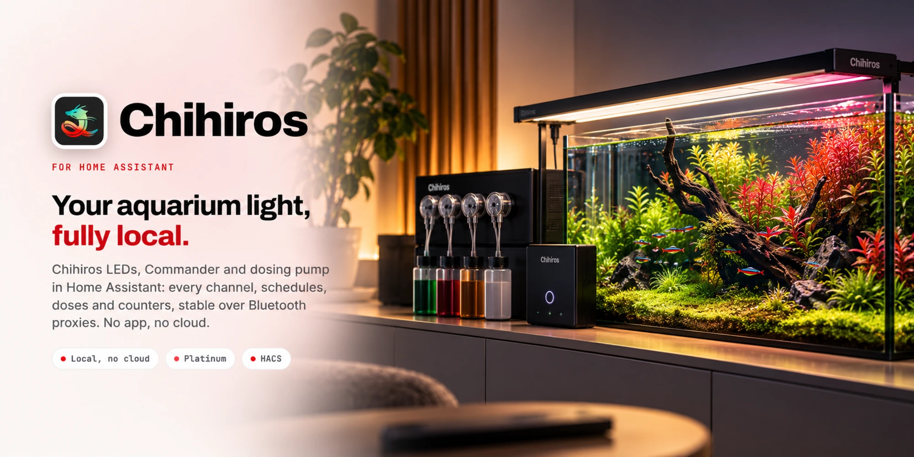
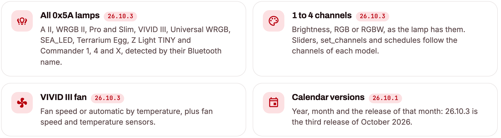
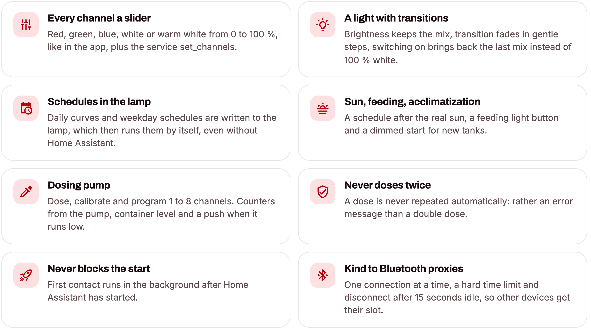
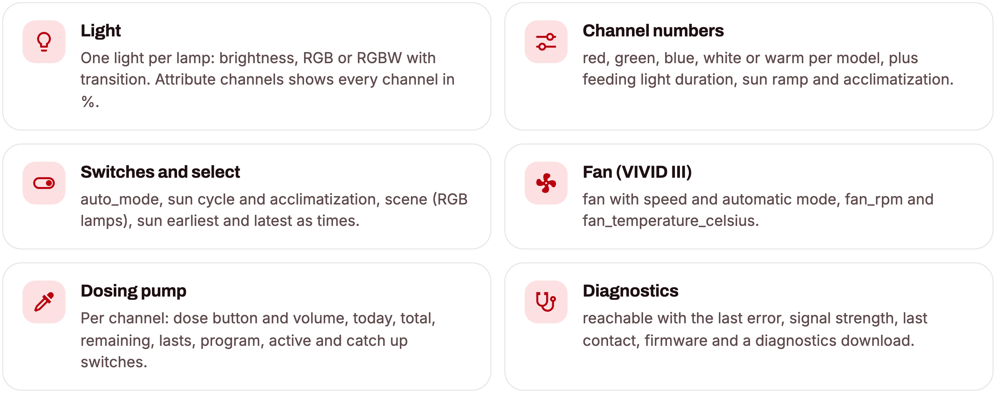
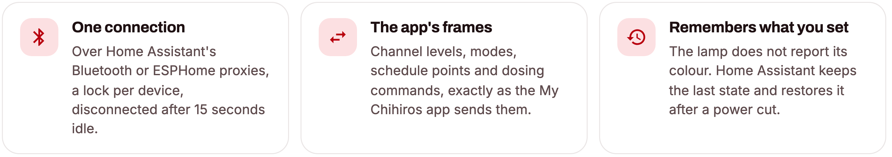

<div align="center">



<p>Chihiros LED lamps and the Chihiros dosing pump in Home Assistant.<br/>
Steady over Bluetooth proxies, no app, no cloud.</p>

[](https://github.com/SH1FT-W/chihiros/releases/latest)
[](https://www.home-assistant.io)
[](https://hacs.xyz)
[](https://developers.home-assistant.io/docs/creating_integration_manifest/#iot-class)
[-e60012?style=flat-square&labelColor=111111)](custom_components/chihiros/quality_scale.yaml)
[](LICENSE)

<p><a href="https://sh1ft-w.github.io/chihiros"><b>Website</b></a> &nbsp;·&nbsp; <a href="#new">New</a> &nbsp;·&nbsp; <a href="#features">Features</a> &nbsp;·&nbsp; <a href="#supported-devices">Devices</a> &nbsp;·&nbsp; <a href="#installation">Install</a> &nbsp;·&nbsp; <a href="#switching-from-the-original-integration">Switching</a> &nbsp;·&nbsp; <a href="#troubleshooting">Troubleshooting</a> &nbsp;·&nbsp; <a href="CHANGELOG.md">Changelog</a></p>

</div>

<br/>

Chihiros controls **Chihiros LED lamps** and the **Chihiros dosing pump** over Bluetooth, directly through Home Assistant's Bluetooth adapter or ESPHome Bluetooth proxies. It is a complete rewrite and succeeds [TheMicDiet/chihiros-led-control](https://github.com/TheMicDiet/chihiros-led-control).

> [!IMPORTANT]
> This integration uses **the same domain `chihiros`** as the original integration and keeps its unique IDs, so entities, history, automations and dashboards stay when you switch. Because of that, **the two cannot be installed at the same time**: remove the original before installing this one.

> [!NOTE]
> Chihiros (this integration) is an independent project. It is not affiliated with, endorsed by or sponsored by Chihiros. Chihiros is a trademark of its owner.

<br/>

<a id="new"></a>
<sub><b>JUST ARRIVED</b></sub>
## Every Chihiros lamp of the 0x5A family.

<picture>
  <source media="(prefers-color-scheme: dark)" srcset="docs/images/readme-cards-new-dark.png" />
  
</picture>

Every change, release by release, in the [changelog](CHANGELOG.md).

<a id="features"></a>
## Features

<picture>
  <source media="(prefers-color-scheme: dark)" srcset="docs/images/readme-cards-features-dark.png" />
  
</picture>

**Lamps**
- Every channel of the lamp **from 0 to 100 %** as a slider and with `chihiros.set_channels`, like in the app.
- One light per lamp: **brightness** (white and two-channel lamps, the mix is kept), **RGB** or **RGBW**, with real **transitions**; switching on without values brings back the last mix.
- **Auto mode:** the lamp plays its stored daily schedule by itself, even without Home Assistant.
- **Write a daily schedule** (`chihiros.set_auto_curve`): points with time and channel levels, the lamp fades between them.
- **Weekday schedules** (`chihiros.set_weekday_schedule`): up to 7 settings with sunrise, sunset, ramp and weekdays, like in the app. Lite controllers only know one setting for every day.
- **Scenes like in the app** (RGB lamps): red plants, green, Buce, fish, shrimp, all, or back to the schedule.
- **Feeding light:** a button makes the light bright for 1 to 120 minutes and then returns to the previous state.
- **Sun cycle:** a schedule after the real sunrise and sunset, limited to "earliest on" and "latest off", recalculated every night.
- **Acclimatization:** a new tank starts dimmed (10 to 100 %) and reaches full brightness after 1 to 12 weeks.
- **After a power cut** Home Assistant sets the clock and, in manual mode, the colour again.
- **WRGB VIVID III:** fan with speed (25 to 100 %) or automatic by temperature, fan speed and temperature sensors.

**Dosing pump**
- Button and dose volume per channel, service `chihiros.dose`. A dose is **never repeated automatically**.
- Counters **today** and **total** from the pump (every 30 minutes and after every dose) plus Home Assistant's own counters.
- **Calibrate** (`chihiros.calibrate_pump`), **dosing program** (`chihiros.set_dosing_program`, the pump then doses by itself), clear the program, reset counters.
- Per channel **pump active** and **catch up missed doses**, plus the pump's **dosing delay**.
- **Container level:** enter the container size, press "container refilled" after refilling, get the remaining volume and how many days it lasts. Optional **push message** when a container runs low, and a repair issue below 10 %.

**Both**
- **Never blocks the start of Home Assistant:** the first contact runs in the background.
- **Kind to Bluetooth proxies:** one connection at a time, a hard time limit, disconnect after 15 seconds idle.
- Diagnostics: reachable (with the last error), signal strength, last contact, firmware, diagnostics download.
- English and German.

## Supported devices

The model is detected from the Bluetooth name; Home Assistant discovers the devices by itself.

| Device | Bluetooth name starts with | Channels | Tested on hardware |
|---|---|---|---|
| C II RGB | `DYNCRGP`, `DYNCRGB` | red, green, blue | **yes** |
| Dosing pump, 1 to 8 channels | `DYDOSE` | | **yes** (4 channels) |
| A II | `DYNA2`, `DYNA2N` | white | no |
| WRGB II | `DYWRGB`, `DYNT90`, `DYNW30`, `DYNW45`, `DYNW60`, `DYNW90`, `DYNW12P`, `DYNWRGB` | red, green, blue | no |
| WRGB II Pro | `DYWPRO30` … `DYWPRO90`, `DYWPR120` | red, green, blue, white | no |
| WRGB II Slim | `DYSILN`, `DYSL30` … `DYSL120`, `DYSL12` | red, green, blue | no |
| WRGB VIVID III | `DYVVD3` | red, green, blue, white + fan | no |
| Universal WRGB | `DYU550` … `DYU1500` | red, green, blue, white | no |
| SEA_LED | `DYSEA` | red, green, blue, white | no |
| Tiny Terrarium Egg | `DYDD` | red, green | no |
| Z Light TINY | `DYSSD`, `DYZSD` | white, warm white | no |
| Commander 1 | `DYCOM` | white, RGB or WRGB (chosen during setup) | no |
| Commander 4 | `DYLED`, `DYNLED` | red, green, blue, white | no |
| Commander X | `DYONE` | white | no |

Lamps marked "no" speak the same protocol as the tested C II RGB and should work. They are built from the protocol documentation of the original integration but **not tested on hardware** yet. If you own one, please [report](https://github.com/SH1FT-W/chihiros/issues/new?template=bug.yml) whether it works, with the model and the Bluetooth name.

**Not supported:** Chihiros heaters (`DYHET`, `DYH1T`) and magnetic stirrers (`DYMIXR`) are left out on purpose. For those, use the [original integration](https://github.com/TheMicDiet/chihiros-led-control) (not at the same time as this one).

## Entities

<picture>
  <source media="(prefers-color-scheme: dark)" srcset="docs/images/readme-cards-entities-dark.png" />
  
</picture>

Entity IDs start with the device name, for new devices the Bluetooth name (for example `light.dyncrgp…`). After switching from the original integration the existing IDs stay.

## Examples

```yaml
# Channels like in the app (only the channels the lamp has)
action: chihiros.set_channels
target:
  entity_id: light.my_lamp
data: {red: 70, green: 70, blue: 70, white: 40, transition: 600}
```

```yaml
# Daily schedule in the lamp, it runs it by itself afterwards
action: chihiros.set_auto_curve
target:
  entity_id: light.my_lamp
data:
  points:
    - {time: "09:00", red: 0, green: 0, blue: 0}
    - {time: "10:00", red: 70, green: 70, blue: 70}
    - {time: "19:00", red: 70, green: 70, blue: 70}
    - {time: "19:30", red: 0, green: 0, blue: 0}
```

```yaml
# Daily dosing program: channel 1, 08:00 and 20:00, 1.5 ml each
action: chihiros.set_dosing_program
data: {device_id: <dosing pump>, pump: 1, times: ["08:00", "20:00"], ml: 1.5}
```

## Actions

| Action | Target | Main fields |
|---|---|---|
| `chihiros.set_channels` | light entity | `red`, `green`, `blue`, `white`, `warm` (0 to 100 %, missing ones stay), `transition` (s) |
| `chihiros.set_auto_curve` | light entity | `points` (2 to 16 × `time` + channels), `activate` |
| `chihiros.set_weekday_schedule` | light entity | `settings` (up to 7 × `weekdays`, `sunrise`, `sunset`, `ramp`, channels) |
| `chihiros.dose` | `device_id`, `pump` | `ml` (empty = the set dose volume) |
| `chihiros.calibrate_pump` | `device_id`, `pump` | first `seconds` (test run), then `measured_ml` |
| `chihiros.set_dosing_program` | `device_id`, `pump` | `mode` (`daily`/`once`/`timer`/`spread`), `times` + `ml` or `doses`, `weekdays`; for `spread` `start`, `duration`, `count`, `daily_ml` |
| `chihiros.clear_dosing_program` | `device_id`, `pump` | |
| `chihiros.reset_pump_totals` | `device_id`, `pump` | |
| `chihiros.set_container_remaining` | `device_id`, `pump` | `ml`: current content, counted down from here |
| `chihiros.send_raw` | `device_id` | `frames` (`cmd`, `mode`, `params`), `wait`; troubleshooting only, returns the replies |

If the device is not reachable or an input does not fit (for example channel 5 on a 4-channel pump or `white` on an RGB lamp), the action reports an error instead of silently doing nothing.

## Installation

### HACS (custom repository)

1. In HACS, open the three dots menu, choose **Custom repositories** and add `https://github.com/SH1FT-W/chihiros` with the type **Integration**.
2. Search for **Chihiros**, download it and restart Home Assistant.

### Manual

1. Download the [latest release](https://github.com/SH1FT-W/chihiros/releases/latest).
2. Copy the folder `custom_components/chihiros` into `/config/custom_components/` and restart Home Assistant.

Requires Home Assistant 2026.9 or newer and a connectable Bluetooth adapter or ESPHome Bluetooth proxy in range.

## Setup

Devices in range are discovered automatically (**Settings > Devices & services**). For the dosing pump the **number of pump channels** (1 to 8, default 4) is asked, for a Commander 1 the **connected lamp** (white, RGB or WRGB). The pump channel count can be changed later with **three dots > Reconfigure**; entities of channels no longer used are removed. The push message for low containers is set with **Configure** on the pump.

## Switching from the original integration

1. In HACS, remove "chihiros" by TheMicDiet. Keep the integration entries.
2. Install this integration (see above) and restart Home Assistant.
3. Existing entries are taken over: entities, history and automations stay.

Two old entities remain as "no longer provided" (`…_last_notification` and `…_calibrate_pump`); calibrating now works with `chihiros.calibrate_pump`.

## Good to know

- **The lamp does not report its colour.** Home Assistant shows its last command, in auto mode the stored schedule. If the lamp is changed with the app or the remote, Home Assistant shows its own state until it sends something again.
- **Reachability** comes from the Bluetooth advertisements: if no proxy sees the device, its entities become unavailable.
- **Checking a written schedule** works only on lamps of the newer (SeaLed) family, up to 8 points and on the first channel; older lamps (Commander X, Commander 1, Commander 4 `DYLED`, WRGB II `DYWRGB`, Terrarium Egg, Z Light TINY) store schedule points in 30-minute steps, like the app.
- **One connection at a time.** Commands to the same device wait for each other; one operation takes at most 40 seconds.
- **Dosing is never repeated.** If the connection breaks during a dose, an error appears: check the counter to see whether it dosed.
- The fan values of the VIVID III are updated whenever Home Assistant talks to the lamp (at least once an hour).

## Troubleshooting

- **Entities "unavailable"** (only "reachable" stays, showing "disconnected"). No Bluetooth proxy sees the device: check power, move a proxy closer or free connection slots on it.
- **Action reports "not reachable".** The reason is in the message and in the "reachable" sensor (attribute `last_error`, plus `connects`/`failures`). Typical: all connection slots of the proxy are in use, or the app still holds the device.
- **Diagnostics:** **Settings > Devices & services > Chihiros > three dots > Download diagnostics**, with connection statistics, stored state and the last events, without the Bluetooth address.
- **Raw commands:** `chihiros.send_raw` sends commands unchanged and returns the replies.
- **Debug log:**

  ```yaml
  logger:
    logs:
      custom_components.chihiros: debug
  ```

When you open an [issue](https://github.com/SH1FT-W/chihiros/issues), please attach the diagnostics file and name the model and the Bluetooth name.

## Removal

1. **Settings > Devices & services > Chihiros > three dots > Delete** (per device). The schedule or dosing program stays stored in the device and keeps running.
2. Delete the folder `/config/custom_components/chihiros` (or remove the repository in HACS) and restart Home Assistant.

## How it works

<picture>
  <source media="(prefers-color-scheme: dark)" srcset="docs/images/readme-cards-how-dark.png" />
  
</picture>

The Bluetooth protocol and the model table follow the documentation of [TheMicDiet/chihiros-led-control](https://github.com/TheMicDiet/chihiros-led-control) (MIT), which decoded the "My Chihiros" app and checked it with captures; thanks for the groundwork. Details are in [`NOTICE`](NOTICE) and, in German, in [`CLAUDE.md`](CLAUDE.md).

## Development

```bash
.venv/bin/python -m pytest -q -p no:logging --cov=custom_components/chihiros   # fake devices in tests/conftest.py
uvx ruff check . && uvx ruff format --check .
uvx mypy@2.3.1 --python-executable .venv/bin/python
.venv/bin/python tools/pruefe-uebersetzungen.py    # strings.json against translations/*.json
```

Install the test requirements with `pip install -r requirements_test.txt`. The tests replace Bluetooth completely with simulated devices. The same checks run on GitHub Actions for every push and pull request, plus HACS validation and hassfest. Self-assessed state of the [Integration Quality Scale](https://developers.home-assistant.io/docs/core/integration-quality-scale/): [`quality_scale.yaml`](custom_components/chihiros/quality_scale.yaml).

## License

[Apache License 2.0](LICENSE), Copyright 2026 SH1FT-W. See [`NOTICE`](NOTICE) for acknowledgements, the license of the original integration and trademarks.
